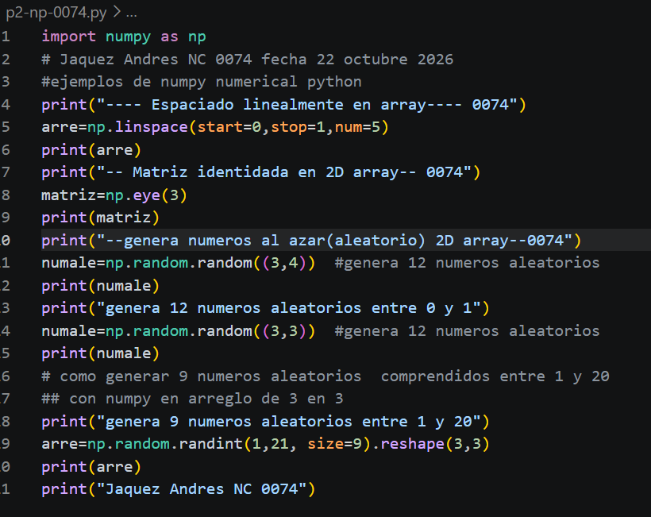
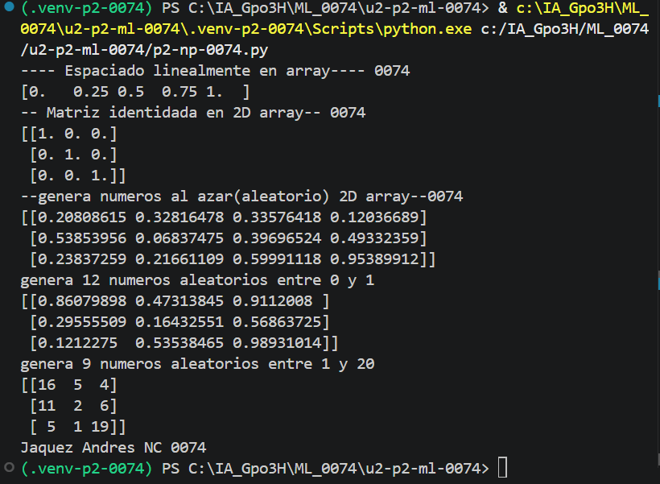

# arre=np.linspace(star=0,stop=1,num=5)
- start=0
  - Indica el valor inicial de la secuencia.
  - En este caso, la serie comienza en 0.
- stop=1
  - Indica el valor final de la secuencia.
  - En este caso, la serie termina en 1 (por defecto, linspace sí incluye este último valor).
- num=5
  - Indica la cantidad de números que se generarán entre start y stop.
  - En este caso, se crean 5 valores distribuidos uniformemente.
  ## QUE ES NP.LINSPACE
  linspace es una función de la biblioteca NumPy de Python que sirve para generar una cantidad determinada de números distribuidos uniformemente entre un valor inicial y uno final.

  ## el codigo 

## resultados

